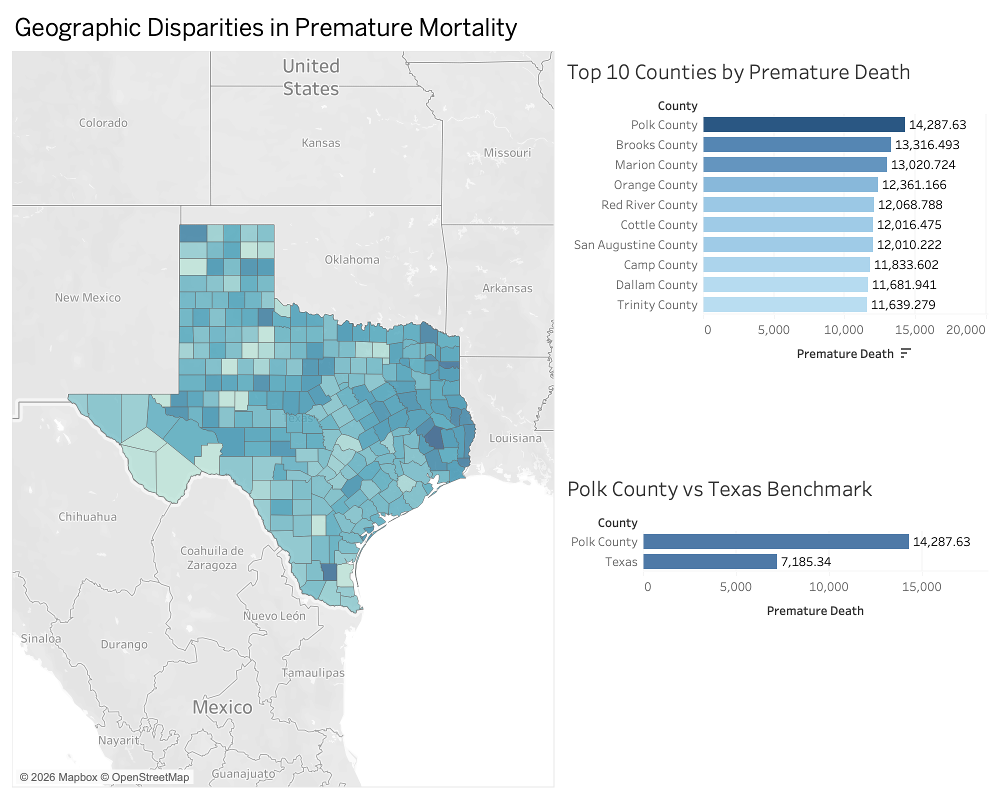
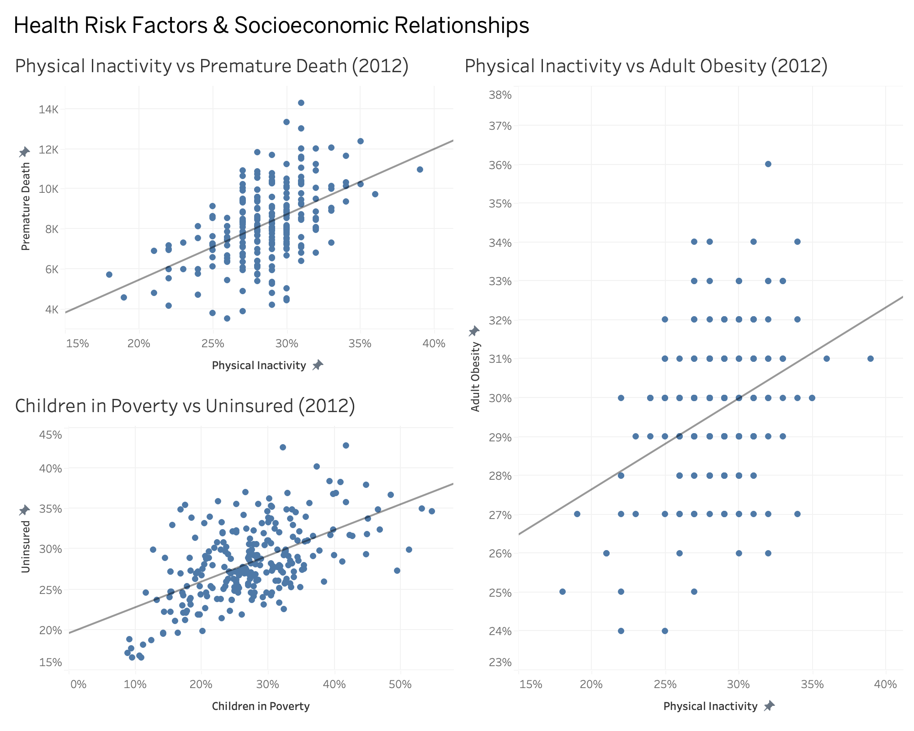

# Texas Health Disparities Analysis

### Geographic Health Inequality, Premature Mortality, and Socioeconomic Risk Factors | 2010–2014

## Project Overview

This project examines geographic, behavioral, and socioeconomic health disparities across 254 Texas counties using Tableau. Through geospatial visualization, comparative analysis, statistical trend lines, interactive dashboards, and animated visualizations, the analysis identifies disparities in health outcomes and explores factors associated with premature mortality.

The findings provide insights that can support public health planning, community outreach, and resource allocation.

## Problem Statement

Health outcomes vary substantially across Texas counties. Understanding the geographic distribution of these disparities and their associated risk factors can help stakeholders identify vulnerable communities and prioritize further investigation.

This analysis addresses three primary research questions:

- How does premature mortality vary across Texas counties?
- What behavioral, socioeconomic, and healthcare factors are associated with differences in health outcomes?
- How do selected health and socioeconomic indicators change across historical data releases?

The objective is to identify geographic disparities, examine associated risk factors, and generate actionable insights for public health decision-making.

## Data Source and Description

**Source:** [County Health Rankings & Roadmaps](https://www.countyhealthrankings.org/), University of Wisconsin Population Health Institute.

| Attribute | Description |
|---|---|
| Geographic Coverage | 254 Texas counties |
| Data Releases | 2010–2014 |
| Primary Analysis Release | 2012 |
| Unit of Analysis | County-level observations |
| Key Measures | 6 |
| Data Type | Public health and socioeconomic indicators |

The 2012 release was used for the primary cross-county analysis, while the 2010–2014 releases supported historical comparisons and animated visualizations.

### Key Variables

| Variable | Description |
|---|---|
| Premature Death | Years of potential life lost before age 75 per 100,000 population |
| Physical Inactivity | Percentage of adults reporting physical inactivity |
| Adult Obesity | Percentage of adults classified as obese |
| Children in Poverty | Percentage of children living in poverty |
| Uninsured | Percentage of the population without health insurance, as defined by the source |
| Unemployment | Unemployment rate |

## Tools and Technologies

- Tableau Desktop
- Geospatial Data Visualization
- Interactive Dashboard Development
- Statistical Trend Lines
- Comparative Benchmarking
- Exploratory Data Analysis
- Animated Visualizations
- Ranking and Filtering
- Data Storytelling

## Analytical Methodology

### Geographic Analysis

County-level choropleth maps were developed to identify geographic variations in premature mortality.

Ranked bar charts were used to identify counties with elevated premature death values, while benchmark comparisons provided context relative to the statewide indicator.

### Health Risk Factor Analysis

Scatterplots and linear trend lines were used to examine relationships between selected health and socioeconomic indicators.

The analysis focused on:

- Physical inactivity and premature mortality
- Physical inactivity and adult obesity
- Childhood poverty and uninsured rates

These relationships were examined descriptively to identify patterns and potential areas for further investigation.

### Comparative Distribution Analysis

Health outcomes were compared across poverty groups to examine differences and variability in premature mortality.

Overlapping distributions were evaluated to understand whether socioeconomic classifications alone adequately distinguish county-level health outcomes.

### Historical Analysis

Animated visualizations were developed using the 2010–2014 data releases to explore changes in premature mortality, childhood poverty, and unemployment.

These visualizations support the identification of potentially persistent health and economic vulnerabilities.

## Interactive Dashboards

### Dashboard 1 — Geographic Disparities in Premature Mortality

This dashboard identifies geographic disparities in premature mortality across Texas counties using the 2012 data release.

Key features include:

- County-level choropleth map
- Top 10 counties ranked by premature mortality
- Polk County comparison against the statewide benchmark
- Geographic identification of elevated mortality indicators

### Dashboard 2 — Health Risk Factors & Socioeconomic Relationships

This dashboard examines relationships between behavioral health indicators, socioeconomic conditions, and health outcomes.

Key features include:

- Physical inactivity versus premature mortality
- Physical inactivity versus adult obesity
- Childhood poverty versus uninsured rates
- Linear trend lines illustrating observed associations

## Key Findings and Insights

### 1. Premature Mortality Varies Substantially Across Texas Counties

Polk County recorded the highest premature mortality value among the displayed county rankings in the 2012 release.

| County | Premature Death |
|---|---:|
| Polk County | 14,287.63 |
| Brooks County | 13,316.49 |
| Marion County | 13,020.72 |
| Orange County | 12,361.17 |
| Red River County | 12,068.79 |

These geographic differences highlight the importance of county-level analysis rather than relying exclusively on statewide health indicators.

### 2. Physical Inactivity Is Associated with Premature Mortality

Counties with higher physical inactivity rates generally exhibited higher premature mortality values.

The positive relationship suggests that physical activity may be a relevant indicator when identifying communities requiring further public health investigation.

However, the observed association does not establish causation.

### 3. Physical Inactivity Is Positively Associated with Adult Obesity

Counties with elevated physical inactivity rates generally displayed higher adult obesity rates.

Kaufman County recorded the highest displayed adult obesity rate of 36.0%.

These findings support further investigation into behavioral health interventions and obesity-prevention initiatives.

### 4. Childhood Poverty Is Associated with Insurance Coverage Gaps

Counties with higher percentages of children living in poverty generally exhibited higher uninsured rates.

This relationship highlights potential socioeconomic barriers to healthcare access and identifies communities that may benefit from targeted outreach and assistance.

### 5. Socioeconomic Conditions Alone Do Not Fully Explain Mortality

Premature mortality distributions across poverty groups exhibited substantial overlap.

This suggests that poverty alone may not adequately explain differences in county-level mortality and that additional behavioral, demographic, and healthcare-related factors should be considered.

### 6. Historical Comparisons Support the Identification of Persistent Vulnerabilities

Animated visualizations across the 2010–2014 releases provide a framework for identifying counties experiencing potentially persistent economic and health vulnerabilities.

These comparisons can support further investigation into communities that may require sustained healthcare outreach and socioeconomic assistance.

## Recommendations

- Prioritize further investigation of counties with multiple overlapping health and socioeconomic risk indicators.
- Evaluate targeted physical activity and obesity-prevention programs in vulnerable communities.
- Investigate healthcare coverage barriers in counties with elevated childhood poverty and uninsured rates.
- Incorporate multiple health and socioeconomic indicators when evaluating resource allocation decisions.
- Use updated public health datasets to assess whether historically observed disparities persist.

## Limitations

| Limitation | Analytical Impact |
|---|---|
| Observational data | Identified relationships cannot establish causation. |
| Historical data releases | Findings may not reflect current health conditions. |
| Release year versus measurement year | Indicators may represent different underlying measurement periods. |
| Missing data | Incomplete observations may limit county-level comparisons. |
| Tied rankings | Counties with identical values may complicate ranking interpretations. |
| County-level aggregation | Within-county health disparities and individual-level differences are not captured. |
| Descriptive statistical analysis | Additional multivariate modeling would be necessary to account for potential confounding factors. |

These limitations should be considered before using the findings to support specific public health interventions or resource allocation decisions.

## Conclusion

The project successfully addressed its primary exploratory objectives by identifying geographic disparities in premature mortality, examining relationships between health and socioeconomic indicators, and comparing selected measures across historical data releases.

The analysis demonstrated that health disparities are multidimensional and that behavioral, economic, and healthcare-related indicators should be considered collectively.

Although the findings do not establish causal relationships or directly determine the effectiveness of specific interventions, they provide a foundation for identifying vulnerable communities, prioritizing further investigation, and supporting evidence-based public health planning.

## Project Files

| File | Description |
|---|---|
| [Tableau Workbook](./workbooks/Texas_Health_Disparities.twbx) | Interactive packaged Tableau workbook |
| [Project Presentation](./presentations/Texas_Health_Disparities_Presentation.pdf) | Analytical findings and recommendations |
| [Dashboard Images](./images/) | Dashboard previews |
| [Source Dataset](https://www.countyhealthrankings.org/) | County Health Rankings & Roadmaps |

## References

- County Health Rankings & Roadmaps
- University of Wisconsin Population Health Institute
- Tableau Free Public Data Sets — Health
- Tableau Public example by Camerino I. Salazar

## Project Contributors

This analysis was developed collaboratively by:

- Ali Manaei
- Minh Quang Truong
- Danning Song

## Portfolio Author

**Minh Truong**

Business Analytics | Data Visualization | Business Intelligence

[GitHub Profile](https://github.com/mqtruong)
