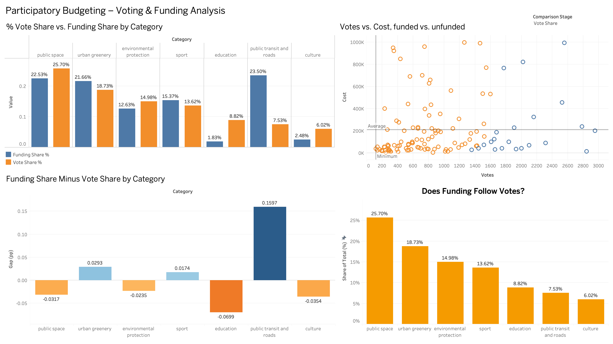

# Participatory Budgeting & Voting Fairness

### Approval Voting, Funding Allocation, and Public Policy Decision-Making

## Project Overview

This project evaluates whether participatory budgeting outcomes reflect voter preferences through an analysis of approval voting and project funding in Ursynów, Poland.

Using Tableau, custom fairness metrics, comparative visualizations, and interactive dashboards, the analysis identifies discrepancies between voter support and funding allocation across project categories.

The findings are used to evaluate the potential adoption of approval voting in Richmond and provide recommendations for transparent and equitable public resource allocation.

## Problem Statement

Participatory budgeting allows residents to influence how public funds are allocated. However, projects receiving substantial voter support may not receive proportional funding due to differences in project costs, voting rules, and budget constraints.

This analysis addresses the following questions:

- Does funding allocation proportionally reflect voter preferences?
- Which project categories receive disproportionately high or low funding relative to voter support?
- How might project costs influence funding outcomes?
- Should Richmond adopt plain approval voting for participatory budgeting?
- What additional evidence is necessary to evaluate voting fairness?

The objective is to evaluate funding proportionality, identify potential representation gaps, and support informed decisions about participatory budgeting design.

## Data Source and Description

**Primary Data Source:** [Pabulib — Participatory Budgeting Library](https://pabulib.org/)

**Business Case:** Participatory Budgeting in Richmond, Darden Business Publishing, University of Virginia.

| Attribute | Description |
|---|---|
| Geographic Coverage | Ursynów, Warsaw, Poland |
| Time Period | 2020 |
| Voting Method | Approval voting |
| Unit of Analysis | Participatory budgeting projects |
| Project Categories | 7 |
| Data Type | Voting results, project costs, and funding decisions |

### Key Variables

| Variable | Description |
|---|---|
| Category | Project classification |
| Votes | Number of approvals received by a project |
| Cost | Estimated project cost |
| Selected | Indicator identifying funded and unfunded projects |
| Vote Share | Category-level proportion of total recorded votes |
| Funding Share | Category-level proportion of total allocated funding |
| Funding Gap | Difference between funding share and vote share |

## Tools and Technologies

- Tableau Desktop
- Calculated Fields
- Category-Level Aggregation
- Table Calculations
- Custom Fairness Metrics
- Interactive Parameters
- Animated Visualizations
- Comparative Data Analysis
- Reference Lines
- Dashboard Development
- Data Storytelling

## Analytical Methodology

### Fairness Evaluation Framework

Voting fairness was evaluated using three primary considerations:

| Dimension | Analytical Objective |
|---|---|
| Proportionality | Determine whether funding broadly reflects voter support. |
| Representation | Evaluate whether smaller community priorities receive consideration. |
| Decision Transparency | Assess whether voting rules and funding outcomes can be clearly communicated. |

Funding proportionality serves as a measurable indicator of alignment between voter preferences and funding outcomes.

### Custom Calculated Fields

**Category Votes**

```tableau
SUM([votes])
```

Calculates total recorded project approvals within each category.

**Category Funded Cost**

```tableau
SUM(
    IF [selected] = 1
    THEN [cost]
    END
)
```

Calculates allocated funding based on the costs of selected projects.

**Vote Share**

```tableau
[Category Votes] / TOTAL([Category Votes])
```

**Funding Share**

```tableau
[Category Funded Cost] / TOTAL([Category Funded Cost])
```

**Funding Gap**

```tableau
[Category Funded Cost] / TOTAL([Category Funded Cost])
-
[Category Votes] / TOTAL([Category Votes])
```

The funding gap measures the difference between a category's funding share and its vote share.

| Funding Gap | Interpretation |
|---|---|
| Positive | Funding share exceeds vote share. |
| Zero | Funding share equals vote share. |
| Negative | Funding share is below vote share. |

Values closer to zero indicate stronger proportional alignment. However, deviations do not independently establish whether an allocation is fair or unfair.

**Funding Status**

```tableau
IF [selected] = 1
THEN "Funded"
ELSE "Not Funded"
END
```

This calculated field enables comparisons between funded and unfunded projects based on voting support and project costs.

## Interactive Dashboard

### Participatory Budgeting — Voting & Funding Analysis



The dashboard integrates four analytical visualizations:

| Visualization | Analytical Purpose |
|---|---|
| Vote Share vs. Funding Share | Compare voter support and allocated funding across categories. |
| Funding Gap by Category | Identify positive and negative deviations from proportional allocation. |
| Votes vs. Project Cost | Examine differences between funded and unfunded projects. |
| Animated Funding Comparison | Dynamically compare the distribution of votes and funding. |

An interactive comparison-stage parameter enables users to explore changes between vote share and funding share.

## Key Findings and Insights

### 1. Funding Allocation Does Not Consistently Reflect Voter Preferences

The analysis identifies differences between vote share and funding share across all seven project categories.

| Category | Vote Share | Funding Share | Gap (pp) |
|---|---:|---:|---:|
| Public Transit and Roads | 7.53% | 23.50% | +15.97 |
| Urban Greenery | 18.73% | 21.66% | +2.93 |
| Sport | 13.62% | 15.37% | +1.74 |
| Environmental Protection | 14.98% | 12.63% | −2.35 |
| Public Space | 25.70% | 22.53% | −3.17 |
| Culture | 6.02% | 2.48% | −3.54 |
| Education | 8.82% | 1.83% | −6.99 |

*pp = percentage points. Minor rounding differences may occur.*

These findings demonstrate that funding allocation does not necessarily mirror the distribution of voter support.

### 2. Public Transit and Roads Received the Largest Positive Funding Gap

Public transit and roads received 23.50% of allocated funding despite accounting for only 7.53% of recorded votes.

The resulting positive gap of 15.97 percentage points was the largest among all project categories.

This discrepancy highlights the importance of evaluating project costs alongside voter preferences.

### 3. Education Received the Largest Negative Funding Gap

Education accounted for 8.82% of voter support but received only 1.83% of allocated funding.

The resulting negative gap of 6.99 percentage points was the largest negative deviation among the analyzed categories.

This outcome warrants further investigation into how voting rules and project selection affect the representation of community priorities.

### 4. The Most Popular Category Did Not Receive the Largest Funding Share

Public space received the highest vote
