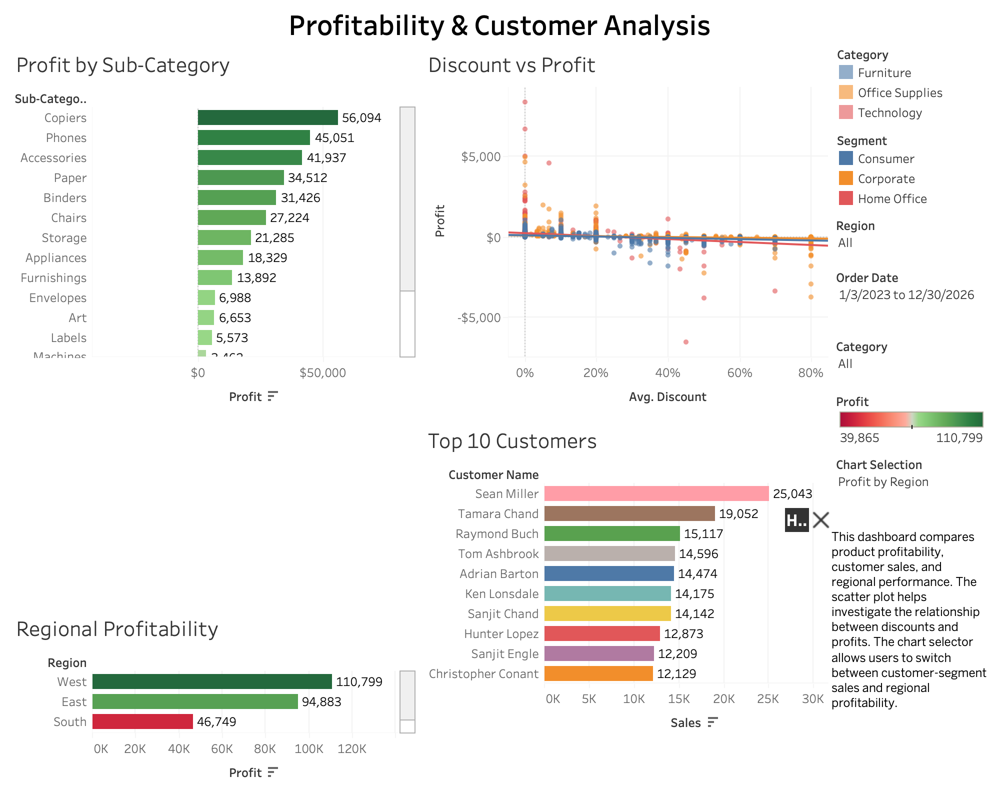
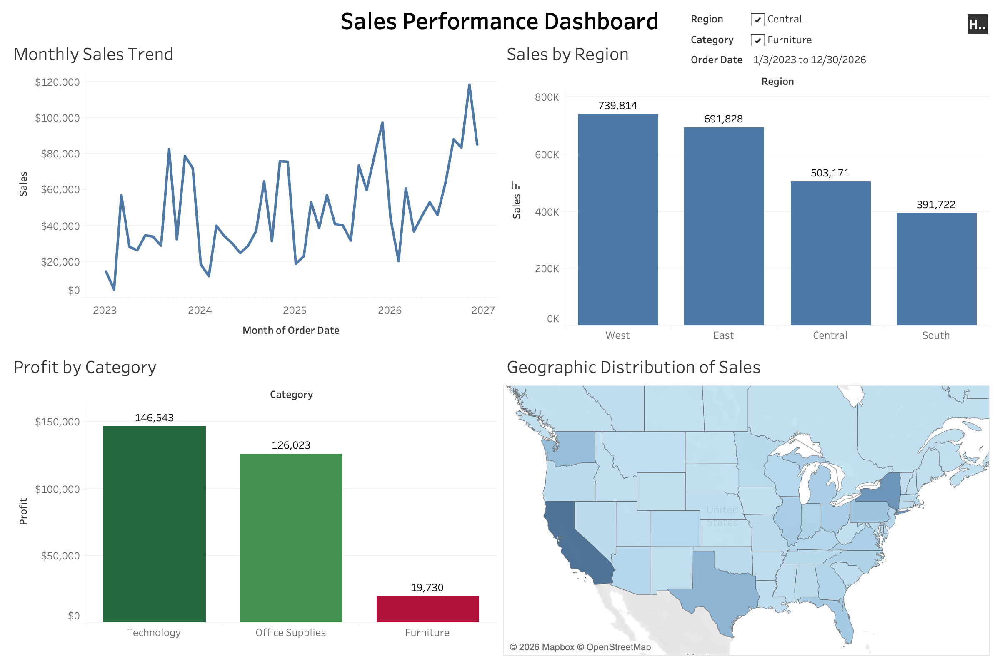

# Superstore Business Analytics

### Retail Sales Performance, Profitability, and Interactive Business Intelligence

## Project Overview

This project analyzes retail sales, profitability, customer performance, and discount strategies using the Sample Superstore dataset.

The analysis combines interactive Tableau dashboards, animated visualizations, custom performance metrics, and geographic analysis to identify business opportunities and potential drivers of declining profitability.

The project consists of two complementary Tableau workbooks:

- **Animated Visualizations:** Exploratory business analysis and animated data storytelling.
- **Interactive Dashboards:** Dynamic business intelligence dashboards supporting multidimensional performance analysis.

## Problem Statement

Strong sales performance does not necessarily translate into strong profitability. Retail organizations must understand how product categories, geographic regions, customer segments, and discount strategies influence financial performance.

This analysis addresses the following questions:

- Which product categories and subcategories generate the highest profitability?
- Which geographic regions contribute most to overall sales and profit?
- How do sales and profit margins change over time?
- How are discounts associated with profitability?
- Which customers and customer segments contribute most to sales?
- How can interactive dashboards improve business performance monitoring?

The objective is to identify profitable business segments, recognize areas of financial underperformance, and generate insights that support retail decision-making.

## Data Source and Description

**Source:** [Tableau Sample Data — Sample Superstore](https://public.tableau.com/app/resources/sample-data)

| Attribute | Description |
|---|---|
| Dataset | Sample Superstore |
| Records | 10,194 order-line observations |
| Variables | 21 fields in the Orders table |
| Date Range | 2023–2026 |
| Geographic Regions | Central, East, South, and West |
| Product Categories | Furniture, Office Supplies, and Technology |
| Data Type | Sample retail transactional data |

The dataset contains order-level product, customer, geographic, and financial information suitable for exploratory retail business analysis.

### Key Variables

| Variable | Description |
|---|---|
| Order Date | Date of customer order |
| Sales | Revenue generated |
| Profit | Profit associated with a transaction |
| Discount | Discount applied to the transaction |
| Quantity | Number of units purchased |
| Region | Geographic sales region |
| State/Province | Geographic location |
| Category | Primary product classification |
| Sub-Category | Detailed product classification |
| Customer Name | Customer identification |
| Segment | Customer market segment |

## Tools and Technologies

- Tableau Desktop
- Interactive Dashboard Development
- Calculated Fields
- Table Calculations
- Dynamic Zone Visibility
- Parameter-Driven Sheet Selection
- Animated Visualizations
- Geographic Mapping
- Dual-Axis Charts
- Heatmaps and Scatterplots
- Business Performance Analysis

## Analytical Methodology

### Key Performance Indicators

Custom calculated fields were developed to evaluate financial performance and compare business segments.

**Profit Margin %**

```tableau
IF SUM([Sales]) != 0 THEN
    SUM([Profit]) / SUM([Sales])
END
```

Measures profitability relative to generated revenue while preventing division by zero.

**Profitability Status**

```tableau
IF SUM([Profit]) >= 0 THEN
    "Profitable"
ELSE
    "Unprofitable"
END
```

Classifies aggregated business performance based on whether profit is positive or negative.

**Regional Sales Contribution %**

```tableau
SUM([Sales]) / TOTAL(SUM([Sales]))
```

Measures each region's contribution to sales within the relevant visualization partition.

**Average Discount %**

```tableau
AVG([Discount])
```

Calculates the average recorded discount within a selected analytical segment.

### Multidimensional Performance Analysis

Sales and profitability were evaluated across multiple dimensions, including:

- Product categories and subcategories
- Geographic regions and states
- Customer segments
- Individual customers
- Historical order dates
- Discount levels

This approach enables comparisons between revenue generation and profitability across different business segments.

## Component 1 — Animated Visualizations

The first Tableau workbook focuses on exploratory retail analysis and animated data storytelling.

### Analytical Worksheets

| Visualization | Analytical Purpose |
|---|---|
| Product Profitability | Identify profitable and unprofitable product subcategories. |
| Regional Sales Rankings | Compare regional contributions to total sales. |
| Sales and Profit Trends | Examine changes in sales and profit margins over time. |
| Regional Profitability Heatmap | Identify profitability patterns across regions and product subcategories. |
| Discount Impact on Profit | Examine relationships between discounts and profitability. |

### Animation Techniques

The workbook also demonstrates several animation techniques:

- Simultaneous mark animations
- Animated regional sales rankings
- Daily sales trend animations
- Historical sales progression

These techniques support the exploration of changing business performance and improve the communication of temporal patterns.

Detailed visualization examples are available in the [Animated Visualizations Presentation](./presentations/Superstore_Animated_Visualizations_Presentation.pdf).

## Component 2 — Interactive Business Intelligence Dashboards

The second workbook focuses on interactive performance monitoring and dynamic visual exploration.

### Dashboard 1 — Profitability & Customer Analysis



This dashboard examines relationships between product profitability, customer performance, and discount strategies.

Key analytical components include:

- Profit by product subcategory
- Discount versus profit analysis
- Customer segment sales
- Top 10 customers
- Regional profitability
- Parameter-driven visualization selection

### Dashboard 2 — Sales & Regional Performance



This dashboard provides a geographic and historical overview of retail performance.

Key analytical components include:

- Monthly sales trends
- Sales by region
- Profit by product category
- Geographic sales distribution
- Interactive filtering

### Dynamic Visualization Selection

A chart-selection parameter enables users to switch between alternative analytical views.

Boolean calculated fields control the visibility of selected visualizations.

**Show Segment Chart**

```tableau
[Chart Selection] = "Sales by Segment"
```

**Show Profit Chart**

```tableau
[Chart Selection] = "Profit by Region"
```

This technique enables multiple analytical perspectives within a single dashboard layout, reducing visual clutter and improving the user experience.

## Key Findings and Insights

The following findings are based on aggregate calculations from the underlying Orders dataset.

### 1. Overall Business Performance

| Metric | Result |
|---|---:|
| Total Sales | $2,326,534 |
| Total Profit | $292,297 |
| Overall Profit Margin | 12.56% |
| Order-Line Records | 10,194 |

The dataset demonstrates positive overall profitability. However, performance varies considerably across regions, product categories, and discount levels.

### 2. Technology Generates the Highest Sales and Profit

| Category | Sales | Profit | Profit Margin |
|---|---:|---:|---:|
| Technology | $839,893 | $146,543 | 17.45% |
| Office Supplies | $731,893 | $126,023 | 17.22% |
| Furniture | $754,748 | $19,730 | 2.61% |

Technology generates the highest overall sales and profit, while Office Supplies maintains a similarly strong profit margin.

Furniture generates substantial revenue but has a significantly lower profit margin, demonstrating that revenue alone is insufficient for evaluating product performance.

### 3. Regional Profitability Varies Substantially

| Region | Sales | Profit | Profit Margin |
|---|---:|---:|---:|
| West | $739,814 | $110,799 | 14.98% |
| East | $691,828 | $94,883 | 13.71% |
| Central | $503,171 | $39,865 | 7.92% |
| South | $391,722 | $46,749 | 11.93% |

The West region leads in both sales and profitability.

The Central region generates more revenue than the South but produces less profit, indicating potential opportunities to investigate regional product mix, pricing, and discount practices.

### 4. Certain Product Subcategories Generate Financial Losses

| Subcategory | Sales | Profit |
|---|---:|---:|
| Tables | $208,020 | −$17,753 |
| Bookcases | $115,361 | −$3,632 |
| Supplies | $46,725 | −$1,171 |

Tables represent the largest aggregate loss among product subcategories despite generating substantial sales.

These results highlight the importance of evaluating profitability at the subcategory level rather than relying solely on category-level revenue.

### 5. Higher Discounts Are Associated with Reduced Profitability

| Discount Level | Aggregate Profit |
|---|---:|
| 0% | $326,719 |
| 10% | $9,100 |
| 20% | $91,080 |
| 30% | −$10,513 |
| 40% | −$23,086 |
| 50% | −$20,506 |
| 70% | −$40,301 |
| 80% | −$30,565 |

Transactions with discount levels of 30% or greater generated aggregate losses at each recorded discount level within the dataset.

Although this pattern suggests that aggressive discounting may contribute to financial underperformance, additional analysis would be necessary to control for differences in product costs, transaction volumes, and product mix.

## Business Recommendations

### Product Portfolio Optimization

- Investigate recurring losses within Tables, Bookcases, and Supplies.
- Evaluate pricing and cost structures for low-margin product subcategories.
- Prioritize profitable product segments when evaluating growth opportunities.

### Discount Strategy

- Review the financial impact of aggressive promotional discounts.
- Establish profitability monitoring thresholds for discounted transactions.
- Evaluate discount effectiveness using profit margins in addition to sales growth.

### Regional Performance

- Investigate the Central region's relatively low profit margin.
- Compare product mix and discount practices across geographic regions.
- Identify potentially transferable practices from higher-performing regions.

### Customer Analytics

- Use customer-level sales and profitability analysis to identify valuable customer relationships.
- Monitor customer segments using financial contribution rather than revenue alone.
- Incorporate customer retention and purchasing behavior into future analyses.

## Limitations

| Limitation | Analytical Impact |
|---|---|
| Sample retail dataset | Findings should not be interpreted as verified performance for an operating retail organization. |
| Observational analysis | Relationships between discounts and profitability do not establish causation. |
| Limited operational cost detail | Individual drivers of product-level losses cannot be fully isolated. |
| Aggregate financial metrics | Transaction-level variation may be obscured by aggregated results. |
| No external market information | Competitor pricing, demand conditions, and broader economic factors are not represented. |
| Descriptive analytical approach | Future business performance cannot be reliably predicted without additional modeling. |
| Static dataset | The dashboards do not connect to a live transactional reporting system. |

## Conclusion

The project successfully addressed its primary analytical objectives by identifying differences in profitability across product categories, geographic regions, and discount levels.

The analysis demonstrated that high sales volumes do not necessarily correspond to high profitability. Furniture, selected product subcategories, and heavily discounted transactions represent areas warranting further financial investigation.

Interactive dashboards, custom performance metrics, and animated visualizations provide a framework for monitoring retail performance and communicating business insights.

Although the sample dataset and descriptive methodology limit real-world generalizability, the project demonstrates how business intelligence tools can support financial performance analysis, identify potential operational inefficiencies, and inform data-driven decision-making.

## Project Files

| File | Description |
|---|---|
| [Animated Visualizations Workbook](./workbooks/Superstore_Animated_Visualizations.twbx) | Exploratory analysis and animated visualizations |
| [Interactive Dashboards Workbook](./workbooks/Superstore_Interactive_Dashboards.twbx) | Interactive business intelligence dashboards |
| [Animated Visualizations Presentation](./presentations/Superstore_Animated_Visualizations_Presentation.pdf) | Visualization examples and animation techniques |
| [Interactive Dashboards Presentation](./presentations/Superstore_Interactive_Dashboards_Presentation.pdf) | Dashboard functionality and analytical features |
| [Dashboard Images](./images/) | Dashboard previews |
| [Source Dataset](https://public.tableau.com/app/resources/sample-data) | Tableau sample datasets |

## Author

**Minh Truong**

Business Analytics | Data Visualization | Business Intelligence

[GitHub Profile](https://github.com/mqtruong)
