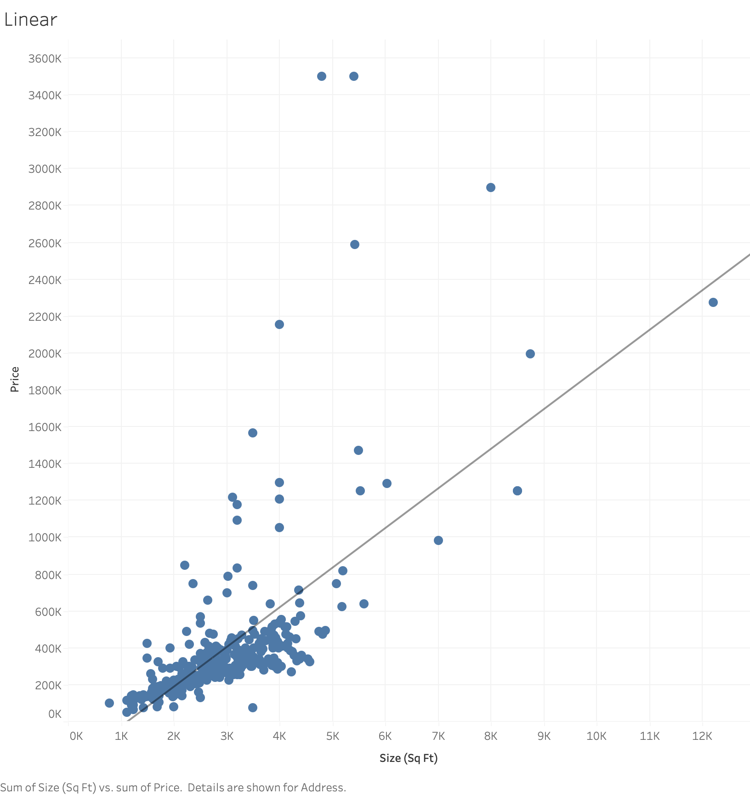
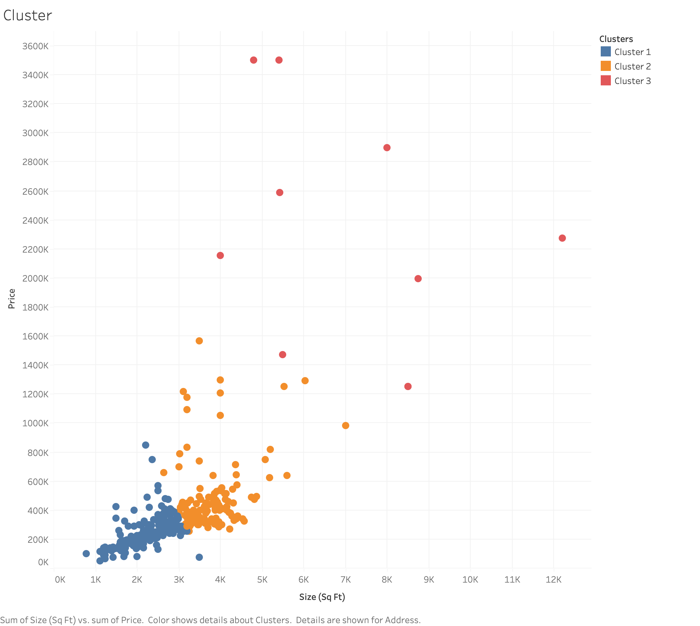
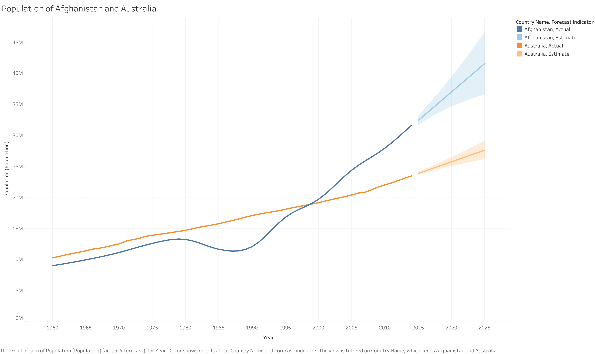

# Advanced Statistical Analysis

### Regression Modeling, Clustering, Time-Series Forecasting, and Exploratory Data Analysis

## Project Overview

This project demonstrates advanced statistical analysis and data visualization techniques using Tableau across three distinct datasets: retail transactions, real estate listings, and historical population data.

The analysis combines regression modeling, unsupervised learning, distribution analysis, forecasting, and advanced visualizations to identify relationships, detect patterns, explore anomalies, and evaluate historical trends.

The packaged Tableau workbook contains 28 worksheets demonstrating descriptive, exploratory, and predictive analytics.

## Problem Statement

Traditional descriptive reporting may not adequately explain relationships between variables, identify underlying patterns, or anticipate future outcomes.

This project addresses the following analytical questions:

- How does property size relate to real estate prices?
- How do alternative regression models represent relationships between property characteristics and prices?
- Can clustering identify properties with similar characteristics?
- How do property prices and sizes vary across sale types?
- How can historical population trends support future population forecasts?
- How can advanced visualizations improve the interpretation of retail business performance?

The objective is to demonstrate how statistical and visualization techniques can support analytical problem-solving across different business and socioeconomic contexts.

## Data Sources and Description

Three datasets were used throughout the analysis.

| Dataset | Records | Variables | Analytical Focus |
|---|---:|---:|---|
| Sample Superstore — Orders | 10,194 | 21 | Retail performance and advanced visualizations |
| Real Estate | 336 | 9 | Regression, clustering, and distribution analysis |
| World Population | 11,984 | 3 | Time-series analysis and forecasting |

### Sample Superstore

**Source:** [Tableau Sample Data](https://public.tableau.com/app/resources/sample-data)

The dataset contains retail transaction information, including sales, profit, customer details, product classifications, geographic locations, and order dates.

### Real Estate

The dataset contains property-level information used to evaluate relationships between property characteristics and prices.

| Variable | Description |
|---|---|
| ID | Property identifier |
| Address | Property location |
| Type of Sale | Property sale classification |
| Price | Recorded property price |
| Size (Sq Ft) | Property size in square feet |
| Baths | Number of bathrooms |
| Beds | Number of bedrooms |
| Latitude | Geographic latitude |
| Longitude | Geographic longitude |

### World Population

The dataset contains historical country-level population observations.

| Variable | Description |
|---|---|
| Country Name | Country identifier |
| Year | Observation year |
| Population | Recorded population |

Afghanistan and Australia were selected for comparative population trend analysis and forecasting.

The Real Estate and World Population datasets are included in the packaged Tableau workbook. Their original publishers were not independently verified.

## Tools and Technologies

- Tableau Desktop
- Regression Analysis
- Statistical Trend Modeling
- K-Means Clustering
- Time-Series Forecasting
- Distribution Analysis
- Outlier Detection
- Tableau Explain Data
- Geographic Visualization
- Calculated Fields
- Table Calculations
- Advanced Data Visualization

## Analytical Methodology

### 1. Regression Modeling

Regression models were applied to examine the relationship between property size and price.

Five alternative trend model configurations were explored:

| Model | Analytical Purpose |
|---|---|
| Linear | Evaluate a constant relationship between property size and price. |
| Logarithmic | Explore relationships characterized by diminishing changes. |
| Exponential | Examine potentially accelerating relationships. |
| Power | Evaluate nonlinear relationships between variables. |
| Polynomial | Explore curved relationships and more complex patterns. |

The analysis also compared trend models with and without sale type as an explanatory factor.

### Linear Regression

The linear regression visualization examines the relationship between property size and price.

Comparing linear and nonlinear specifications demonstrates how model selection can influence the interpretation of relationships within a dataset.

The analysis is exploratory and does not establish which regression model provides the best out-of-sample predictive performance.

### 2. Clustering Analysis

Tableau clustering was used to identify groups of properties with similar price and size characteristics.

The clustering analysis demonstrates how unsupervised learning can support:

- Property segmentation
- Identification of similar property groups
- Exploration of unusual observations
- Comparison of property characteristics
- Geographic examination of cluster distributions

A separate geographic visualization displays property clusters using latitude and longitude.

### 3. Distribution and Outlier Analysis

Property price and size distributions were examined across sale types.

Distribution visualizations were used to identify variation, potential outliers, and differences between property groups.

Tableau Explain Data was also explored to investigate unusual observations and potential statistical explanations.

These techniques support exploratory investigation but do not independently establish the underlying causes of unusual property values.

### 4. Time-Series Analysis and Forecasting

Historical population data was analyzed to examine population growth patterns in Afghanistan and Australia.

The analysis included:

- Historical population trends
- Statistical trend lines
- Comparisons across historical periods
- Future population forecasts

The forecasting visualization demonstrates how historical time-series observations can be used to estimate future population values.

Forecasts represent model-based estimates rather than guaranteed future outcomes.

### 5. Advanced Retail Visualizations

The Sample Superstore dataset was used to demonstrate advanced visualization techniques supporting retail business analysis.

| Visualization | Analytical Purpose |
|---|---|
| Slope Chart | Compare state sales rankings between two periods. |
| Bump Chart | Track changes in state rankings across multiple years. |
| Waterfall Chart | Examine product subcategory contributions to cumulative profit. |
| Step Line Chart | Display cumulative profit using step-shaped transitions. |
| Jump Line Chart | Highlight changes in cumulative profit across subcategories. |
| Sparklines | Display compact sales trends by product subcategory. |
| Dumbbell Chart | Compare regional performance across product subcategories. |
| Unit or Symbol Chart | Represent regional sales using repeated symbols. |
| Marimekko Chart | Examine sales composition across regions and product categories. |

Additional visualization examples are available in the project presentation.

## Key Findings and Insights

### 1. Property Size Provides a Basis for Price Analysis

Property size is a relevant variable for examining real estate pricing.

Comparing multiple regression model configurations provides alternative perspectives on the relationship between property size and price.

However, property characteristics such as location, sale type, and number of bedrooms and bathrooms should also be considered when developing a comprehensive valuation model.

### 2. Model Selection Influences Analytical Interpretation

Linear, logarithmic, exponential, power, and polynomial trend models represent relationships differently.

The comparison demonstrates the importance of evaluating model assumptions, goodness of fit, and predictive performance before selecting a regression specification for practical applications.

### 3. Clustering Supports Property Segmentation

Clustering provides a framework for identifying groups of properties with similar price and size characteristics.

These groups can support comparative property analysis and further investigation of market segments.

Geographic cluster visualization adds spatial context to the statistical segmentation.

### 4. Distribution Analysis Supports Anomaly Detection

Distribution visualizations and Explain Data provide complementary techniques for identifying unusual property observations.

Such observations may warrant additional investigation into property characteristics, data quality, or market conditions rather than automatic exclusion from the analysis.

### 5. Historical Population Trends Support Forecast Development

Comparative time-series analysis provides a framework for examining historical population growth in Afghanistan and Australia.

Forecasting extends the historical analysis by producing estimates of future population values, demonstrating the potential application of predictive analytics to demographic planning.

### 6. Advanced Visualizations Improve Business Performance Analysis

Retail visualizations demonstrate several approaches to communicating changes in rankings, cumulative profitability, sales composition, and historical performance.

Selecting visualizations based on the analytical question can improve the communication of complex business information.

## Recommendations

- Evaluate regression models using goodness-of-fit statistics, residual analysis, and out-of-sample validation.
- Incorporate additional property characteristics when developing real estate valuation models.
- Validate cluster stability before using segmentation results for business decisions.
- Investigate potential outliers before removing them from datasets.
- Evaluate forecast accuracy using historical holdout periods and appropriate error metrics.
- Select visualization techniques based on the analytical objective and intended audience.

## Limitations

| Limitation | Analytical Impact |
|---|---|
| Limited real estate sample | The 336 property observations may not represent broader real estate markets. |
| Unverified original data provenance | The collection methodology and representativeness of the real estate and population datasets cannot be fully assessed. |
| Single-predictor regression | Property size alone cannot capture all factors influencing property prices. |
| No out-of-sample model validation | The comparative predictive accuracy of regression models was not established. |
| Exploratory clustering | Cluster stability and business usefulness were not independently validated. |
| Historical forecasting assumptions | Unexpected demographic, economic, or policy changes may affect future population outcomes. |
| No documented forecast accuracy assessment | Forecast reliability cannot be fully established without backtesting. |
| Sample retail dataset | Retail findings should not be interpreted as verified performance for an operating business. |

## Conclusion

The project successfully demonstrates the application of advanced statistical and visualization techniques across retail, real estate, and demographic datasets.

Regression modeling, clustering, distribution analysis, and forecasting provide complementary approaches to exploring relationships, identifying patterns, and estimating future outcomes.

The project achieves its exploratory and methodological objectives. However, additional validation would be necessary before deploying the regression, clustering, or forecasting models in operational decision-making.

The analysis demonstrates the ability to select and apply appropriate analytical techniques, communicate statistical information through visualizations, and recognize the limitations of analytical results.

## Project Files

| File | Description |
|---|---|
| [Tableau Workbook](./workbooks/Advanced_Statistical_Analysis.twbx) | Packaged workbook containing 28 analytical worksheets and supporting datasets |
| [Project Presentation](./presentations/Advanced_Statistical_Analysis_Presentation.pdf) | Statistical analysis and advanced visualization examples |
| [Visualization Images](./images/) | Selected regression, clustering, and forecasting previews |

## Author

**Minh Truong**

Business Analytics | Data Visualization | Statistical Analysis | Business Intelligence

[GitHub Profile](https://github.com/mqtruong)
