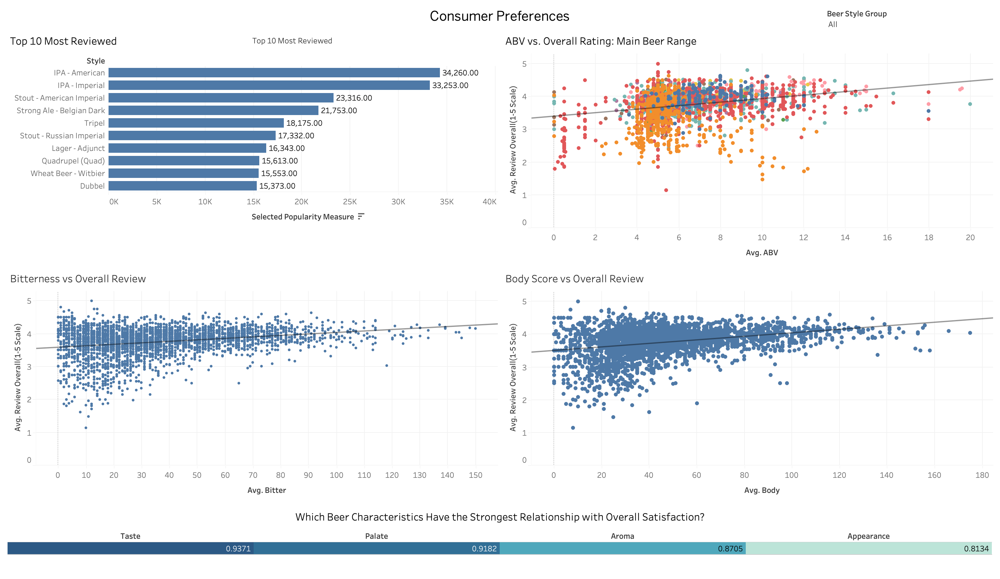
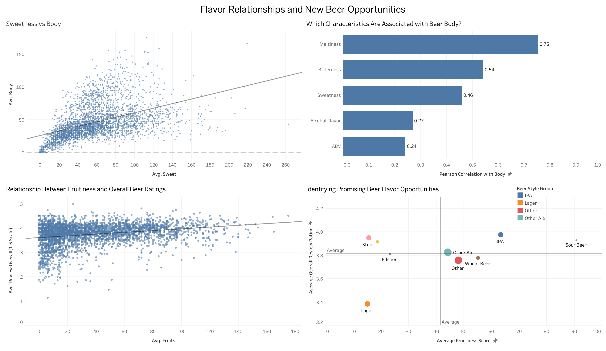

# Consumer Preferences & Product Development Analytics

### Consumer Satisfaction, Product Characteristics, and Data-Driven Product Innovation

## Project Overview

This project analyzes beer reviews, consumer preferences, and product characteristics to identify factors associated with customer satisfaction and potential opportunities for new product development.

Using Tableau, Pearson correlation analysis, statistical trend lines, dynamic product rankings, interactive dashboards, and opportunity mapping, the analysis explores relationships between sensory characteristics, product popularity, and overall consumer ratings.

The findings provide a data-driven framework for supporting product development, market positioning, and consumer preference analysis.

## Problem Statement

Developing new products requires understanding which product characteristics consumers value and identifying opportunities that align with customer preferences.

Product popularity alone may not adequately explain customer satisfaction or indicate which characteristics should be prioritized during product development.

This analysis addresses the following questions:

- Which beer styles receive the most consumer reviews?
- Which sensory characteristics have the strongest relationships with overall consumer satisfaction?
- How do alcohol content, bitterness, and body relate to overall product ratings?
- Which flavor characteristics are most strongly associated with beer body?
- Which beer styles represent promising opportunities for new product development?

The objective is to translate consumer review data into actionable product development insights.

## Data Source and Description

**Source:** Beer review and product characteristics dataset, `UV8620-XLS-ENG.xlsx`, provided as supporting business case study material.

| Attribute | Description |
|---|---|
| Analytical Domain | Consumer preferences and product development |
| Unit of Analysis | Beer-level product characteristics and aggregated reviews |
| Consumer Rating Scale | 1–5 |
| Data Type | Product characteristics, sensory attributes, and consumer review metrics |
| Analytical Scope | Product popularity, satisfaction, and flavor relationships |

### Key Variables

| Variable | Description |
|---|---|
| Style | Detailed beer style classification |
| ABV | Alcohol by volume |
| Number of Reviews | Recorded consumer review volume |
| Overall Rating | Overall consumer satisfaction score |
| Taste Rating | Consumer evaluation of taste |
| Aroma Rating | Consumer evaluation of aroma |
| Palate Rating | Consumer evaluation of palate |
| Appearance Rating | Consumer evaluation of appearance |
| Body | Recorded beer body characteristic |
| Sweet | Sweetness characteristic |
| Bitter | Bitterness characteristic |
| Malty | Maltiness characteristic |
| Fruits | Fruitiness characteristic |
| Alcohol | Alcohol flavor characteristic |

Review volume is used as a proxy for product popularity rather than a direct measure of sales or market share.

## Tools and Technologies

- Tableau Desktop
- Pearson Correlation Analysis
- Statistical Trend Lines
- Calculated Fields
- Interactive Parameters
- Dynamic Ranking
- Product Segmentation
- Scatterplots
- Correlation Heatmaps
- Opportunity Matrix
- Interactive Dashboard Development
- Tableau Stories and Data Storytelling

## Analytical Methodology

### 1. Product Segmentation

Detailed beer styles were consolidated into broader product groups using a custom calculated field.

```tableau
IF CONTAINS(LOWER([Style]), "ipa") THEN "IPA"
ELSEIF CONTAINS(LOWER([Style]), "stout") THEN "Stout"
ELSEIF CONTAINS(LOWER([Style]), "porter") THEN "Porter"
ELSEIF CONTAINS(LOWER([Style]), "lager") THEN "Lager"
ELSEIF CONTAINS(LOWER([Style]), "pilsner") THEN "Pilsner"
ELSEIF CONTAINS(LOWER([Style]), "wheat") THEN "Wheat Beer"
ELSEIF CONTAINS(LOWER([Style]), "sour") THEN "Sour Beer"
ELSEIF CONTAINS(LOWER([Style]), "ale") THEN "Other Ale"
ELSE "Other"
END
```

This segmentation enables comparisons across broader product categories and simplifies the interpretation of consumer preference patterns.

### 2. Dynamic Product Popularity Rankings

An interactive parameter enables users to switch between two product ranking perspectives:

- Most Reviewed
- Highest Rated

**Selected Popularity Measure**

```tableau
IF [Popularity Metric] = "Highest Rated" THEN
    AVG([review_overall(1-5 scale)])
ELSE
    SUM([number_of_reviews])
END
```

**Dynamic Top 10 Rank**

```tableau
RANK_DENSE([Selected Popularity Measure], 'desc')
```

This approach distinguishes consumer engagement from average product satisfaction while enabling interactive product comparisons.

### 3. Consumer Satisfaction Correlation Analysis

Pearson correlation coefficients were calculated to evaluate relationships between individual review dimensions and overall product ratings.

**Taste vs. Overall Rating**

```tableau
CORR(
    [review_taste(1-5 scale)],
    [review_overall(1-5 scale)]
)
```

Equivalent calculations were developed for aroma, palate, and appearance.

The correlation results were presented in a heatmap to identify which review dimensions have the strongest observed relationships with overall consumer satisfaction.

### 4. Flavor Relationship Analysis

Pearson correlation analysis was also used to examine relationships between beer body and selected sensory characteristics.

**Maltiness vs. Body**

```tableau
CORR([Body], [Malty])
```

**Sweetness vs. Body**

```tableau
CORR([Body], [Sweet])
```

Additional correlations were calculated for bitterness, alcohol flavor, and ABV.

Scatterplots and statistical trend lines provide complementary visual evidence of these relationships.

### 5. Product Opportunity Matrix

A product opportunity matrix was developed to compare beer style groups using:

- Average fruitiness score
- Average overall consumer rating

Average reference lines divide the visualization into comparative quadrants, highlighting product groups with above-average fruitiness and above-average consumer satisfaction.

The matrix serves as an exploratory product development tool rather than a definitive measure of commercial opportunity.

## Interactive Dashboards

### Dashboard 1 — Consumer Preferences



This dashboard examines product popularity, consumer satisfaction, and relationships between selected product characteristics and overall ratings.

Key features include:

- Dynamic Top 10 beer style rankings
- Interactive beer style group filtering
- Alcohol content versus overall rating
- Bitterness versus overall rating
- Body versus overall rating
- Consumer satisfaction correlation heatmap
- Statistical trend lines

### Dashboard 2 — Flavor Relationships & Product Opportunities



This dashboard focuses on sensory relationships and potential opportunities for new product development.

Key features include:

- Sweetness versus beer body analysis
- Ranked Pearson correlations with beer body
- Fruitiness versus overall consumer rating
- Beer style opportunity matrix
- Average reference lines for comparative product positioning

## Data Storytelling

Two Tableau stories were developed to organize the analytical findings into structured narratives.

| Story | Analytical Purpose |
|---|---|
| Understanding Consumer Preferences | Examine product popularity and characteristics associated with consumer satisfaction. |
| Developing the Next Beer | Translate flavor relationships and consumer ratings into potential product development opportunities. |

These stories connect exploratory analysis with business-oriented recommendations.

## Key Findings and Insights

### 1. IPA Styles Generate Substantial Consumer Engagement

The most-reviewed beer styles displayed in the dashboard include:

| Beer Style | Review Count |
|---|---:|
| IPA — American | 34,260 |
| IPA — Imperial | 33,253 |
| Stout — American Imperial | 23,316 |
| Strong Ale — Belgian Dark | 21,753 |
| Tripel | 18,175 |

American and Imperial IPA styles received the highest review volumes.

These results indicate substantial engagement within the review dataset, although review volume should not be interpreted as a direct measure of market demand or sales performance.

### 2. Taste Has the Strongest Relationship with Overall Consumer Satisfaction

| Review Characteristic | Pearson Correlation |
|---|---:|
| Taste | 0.9371 |
| Palate | 0.9182 |
| Aroma | 0.8705 |
| Appearance | 0.8134 |

All four review characteristics exhibit strong positive correlations with overall consumer ratings.

Taste demonstrates the strongest observed relationship, followed by palate and aroma.

These findings suggest that sensory experience should be an important consideration during product development. However, the correlations do not establish independent causal effects.

### 3. Maltiness Has the Strongest Relationship with Beer Body

| Characteristic | Pearson Correlation with Body |
|---|---:|
| Maltiness | 0.75 |
| Bitterness | 0.54 |
| Sweetness | 0.46 |
| Alcohol Flavor | 0.27 |
| ABV | 0.24 |

Maltiness exhibits the strongest positive correlation with beer body among the evaluated characteristics.

Bitterness and sweetness demonstrate moderate positive relationships, while alcohol flavor and ABV exhibit comparatively weaker relationships.

These findings provide potential starting points for developing products with specific body characteristics.

### 4. Higher Alcohol Content Does Not Guarantee Higher Consumer Satisfaction

The comparison between ABV and overall ratings displays a positive fitted trend alongside substantial variation.

Products with similar alcohol content can receive noticeably different consumer ratings.

This suggests that alcohol content alone is insufficient for explaining consumer satisfaction and should be evaluated alongside other product characteristics.

### 5. Fruitiness Represents a Potential Product Development Opportunity

The fruitiness versus overall rating visualization displays a positive fitted trend.

The product opportunity matrix identifies IPA and sour beer as product groups combining above-average fruitiness with above-average overall ratings.

These product groups represent potential candidates for further product concept development and consumer testing.

The analysis does not establish an optimal fruitiness level or demonstrate that increasing fruitiness will necessarily improve consumer satisfaction.

### 6. Product Popularity and Consumer Satisfaction Measure Different Outcomes

The dynamic ranking parameter distinguishes review volume from average product ratings.

A product with substantial consumer engagement may not necessarily achieve the highest average rating.

Evaluating both measures provides a more comprehensive understanding of consumer preferences than relying on a single popularity metric.

## Business Recommendations

### Product Development Strategy

- Prioritize taste and palate when developing and evaluating new product concepts.
- Explore fruit-forward IPA and sour beer concepts through controlled consumer testing.
- Investigate maltiness when developing products with fuller body characteristics.
- Evaluate flavor balance rather than optimizing individual characteristics in isolation.

### Product Portfolio and Market Positioning

- Evaluate consumer engagement alongside average product satisfaction.
- Use product segmentation to identify differentiated positioning opportunities.
- Investigate highly rated product groups with distinct sensory characteristics.
- Incorporate competitive positioning, pricing, and market demand into future opportunity assessments.

### Additional Analysis

- Conduct multivariate analysis to evaluate the independent relationships between product characteristics and consumer satisfaction.
- Incorporate sales, production costs, and profitability data into product development decisions.
- Validate proposed product concepts using representative consumer panels and controlled taste tests.
- Examine consumer preference differences across demographic and geographic segments.

## Limitations

| Limitation | Analytical Impact |
|---|---|
| Observational review data | Statistical associations cannot establish causation. |
| Consumer review selection bias | Individuals submitting reviews may not represent the broader consumer population. |
| Review count as a popularity proxy | Review volume does not directly measure sales, market share, or purchase intent. |
| Correlated review dimensions | Taste, palate, aroma, and overall ratings may reflect overlapping aspects of consumer satisfaction. |
| Aggregated product characteristics | Individual consumer preferences and variation may be obscured. |
| Limited demographic information | Consumer preferences cannot be comprehensively segmented by demographic characteristics. |
| No financial or commercial data | Product profitability, pricing feasibility, and commercial viability cannot be established. |
| Exploratory opportunity matrix | Above-average ratings and fruitiness do not independently establish market opportunities. |
| No controlled product testing | Proposed product development opportunities remain hypotheses requiring validation. |
| Limited data provenance | The original collection methodology and dataset coverage were not independently verified. |

These limitations should be considered before translating exploratory findings into commercial product development decisions.

## Conclusion

The project successfully addressed its primary exploratory objectives by identifying highly reviewed product styles, quantifying relationships between product characteristics and consumer satisfaction, and highlighting potential product development opportunities.

Taste and palate demonstrated the strongest relationships with overall consumer ratings, while maltiness exhibited the strongest relationship with beer body.

The product opportunity matrix identified fruit-forward IPA and sour beer concepts as candidates for further investigation.

Interactive dashboards, custom calculations, correlation analysis, and structured data storytelling provide a framework for translating consumer review data into product development insights.

Although the analysis cannot establish causal relationships or guarantee commercial success, it provides a foundation for generating product hypotheses, prioritizing consumer research, and supporting evidence-based product innovation.

## Project Files

| File | Description |
|---|---|
| [Tableau Workbook](./workbooks/Consumer_Preferences_Analysis.twbx) | Interactive packaged workbook containing 18 analytical worksheets and two Tableau stories |
| [Consumer Preferences Dashboard](./images/Consumer_Preferences_Dashboard.png) | Consumer satisfaction and product popularity analysis |
| [Flavor Opportunity Dashboard](./images/Flavor_Opportunity_Dashboard.png) | Sensory relationships and product opportunity analysis |

## Author

**Minh Truong**

Business Analytics | Consumer Analytics | Product Analytics | Data Visualization

[GitHub Profile](https://github.com/mqtruong)
