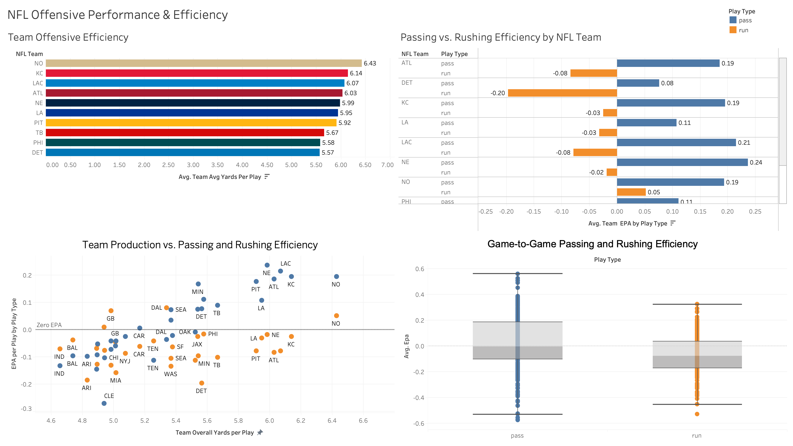

# NFL Offensive Efficiency Analytics

### Team Performance Benchmarking, Expected Points Added, and Offensive Strategy Analysis

## Project Overview

This project examines NFL offensive performance using historical play-by-play data and advanced football analytics metrics.

Using Tableau, FIXED Level of Detail (LOD) expressions, comparative analysis, interactive filtering, and statistical distributions, the analysis evaluates offensive production, passing efficiency, rushing efficiency, and game-to-game performance variability.

The objective is to demonstrate how advanced performance metrics provide additional context beyond traditional measures such as yards gained.

## Problem Statement

Traditional football statistics, such as total yards and yards per play, provide useful measures of offensive production but do not necessarily capture the scoring value generated by individual plays.

This analysis addresses the following questions:

- Which NFL teams generate the highest offensive production per play?
- How does passing efficiency compare with rushing efficiency?
- Does higher offensive production correspond to higher scoring efficiency?
- Which teams demonstrate positive efficiency across both passing and rushing plays?
- How does offensive efficiency vary from game to game?

The objective is to develop a multidimensional framework for evaluating offensive performance using both traditional and advanced football metrics.

## Data Source and Description

**Source:** NFL Play by Play 2009–2018 (v5), CSV dataset.

| Attribute | Description |
|---|---|
| League | National Football League |
| Dataset Coverage | 2009–2018 |
| Selected Analysis Season | 2017 |
| Unit of Analysis | Individual football plays |
| Primary Play Types | Pass and run |
| Data Type | Historical play-by-play performance data |

The dashboard focuses on the 2017 NFL season, selected from the broader historical dataset.

### Key Variables

| Variable | Description |
|---|---|
| posteam | Offensive team in possession |
| play_type | Classification of offensive play |
| yards_gained | Number of yards gained during a play |
| epa | Expected Points Added |
| game_date | Date of the game |
| game_id | Game identifier |
| Season | Calculated NFL season |

### Key Performance Metrics

**Yards per Play (YPP)**

Measures average offensive yardage generated per play.

**Expected Points Added (EPA)**

Measures the change in expected scoring value associated with a play, accounting for its game-state context.

Positive EPA indicates an increase in expected scoring value, while negative EPA indicates a decrease.

Unlike yards per play, EPA provides additional context about the value of offensive production.

## Tools and Technologies

- Tableau Desktop
- FIXED Level of Detail (LOD) Expressions
- Calculated Fields
- Context Filters
- Interactive Dashboard Actions
- Top N Ranking
- Comparative Performance Analysis
- Statistical Distribution Analysis
- Box-and-Whisker Plots
- Scatterplots and Reference Lines
- Sports Analytics

## Analytical Methodology

### 1. Season Classification

A calculated field assigns games played in January or February to the preceding NFL season.

```tableau
IF MONTH(DATE([game_date])) <= 2 THEN
    YEAR(DATE([game_date])) - 1
ELSE
    YEAR(DATE([game_date]))
END
```

This ensures that games occurring after the calendar year ends are associated with the appropriate football season under the dataset's season-classification approach.

### 2. Team Average Yards per Play

```tableau
{ FIXED [posteam] :
    AVG(
        IF [play_type] = "pass"
        OR [play_type] = "run"
        THEN [yards_gained]
        END
    )
}
```

This calculation measures average offensive yardage across passing and rushing plays at the team level.

### 3. Team EPA by Play Type

```tableau
{ FIXED [posteam], [play_type] :
    AVG(
        IF [play_type] = "pass"
        OR [play_type] = "run"
        THEN [epa]
        END
    )
}
```

This calculation evaluates passing and rushing efficiency independently for each team.

### 4. League-Relative Efficiency

Additional calculations were developed within the workbook to compare team-season EPA against league-season EPA.

These calculations provide a framework for classifying team performance as at or above the league average or below the league average.

### 5. Context Filtering

Season filters were configured as context filters to ensure that FIXED LOD calculations reflect the selected analytical season.

This enables consistent team-level comparisons within the selected historical period.

## Interactive Dashboard

### NFL Offensive Performance & Efficiency

[](./images/NFL_Offensive_Efficiency_Dashboard.png)

The dashboard integrates four complementary visualizations.

| Visualization | Analytical Purpose |
|---|---|
| Team Offensive Efficiency | Rank the top 10 teams by average yards per play. |
| Passing vs. Rushing Efficiency | Compare average EPA across offensive play types. |
| Team Production vs. Efficiency | Evaluate relationships between yards per play and EPA. |
| Game-to-Game Efficiency | Compare passing and rushing EPA distributions across games. |

Interactive dashboard actions enable team-level exploration, while reference lines provide context for distinguishing positive and negative EPA.

## Key Findings and Insights

### 1. New Orleans Led Offensive Production

The top 10 teams displayed in the 2017 offensive production ranking were:

| Rank | Team | Average Yards per Play |
|---:|---|---:|
| 1 | New Orleans Saints | 6.43 |
| 2 | Kansas City Chiefs | 6.14 |
| 3 | Los Angeles Chargers | 6.07 |
| 4 | Atlanta Falcons | 6.03 |
| 5 | New England Patriots | 5.99 |
| 6 | Los Angeles Rams | 5.95 |
| 7 | Pittsburgh Steelers | 5.92 |
| 8 | Tampa Bay Buccaneers | 5.67 |
| 9 | Philadelphia Eagles | 5.58 |
| 10 | Detroit Lions | 5.57 |

New Orleans generated the highest average offensive yardage per play among the teams displayed.

### 2. Passing Generally Generated Higher EPA Than Rushing

Selected teams demonstrated substantial differences between passing and rushing efficiency.

| Team | Passing EPA per Play | Rushing EPA per Play |
|---|---:|---:|
| New England | +0.24 | -0.02 |
| Los Angeles Chargers | +0.21 | -0.08 |
| Kansas City | +0.19 | -0.03 |
| Atlanta | +0.19 | -0.08 |
| New Orleans | +0.19 | +0.05 |
| Detroit | +0.08 | -0.20 |

Passing generated higher average EPA than rushing for each of these displayed teams.

However, these descriptive results do not establish that increasing passing frequency would necessarily improve offensive performance.

### 3. New Orleans Demonstrated Balanced Offensive Efficiency

In addition to leading the yards-per-play ranking, New Orleans generated positive average EPA across both passing and rushing plays.

- Average yards per play: 6.43
- Passing EPA per play: +0.19
- Rushing EPA per play: +0.05

This combination highlights a team demonstrating both high offensive production and positive scoring efficiency across multiple play types.

### 4. Offensive Production and Efficiency Are Distinct Performance Measures

The relationship between yards per play and EPA demonstrates that offensive yardage alone does not fully describe offensive effectiveness.

For example, New England generated fewer yards per play than New Orleans but recorded higher passing EPA.

This distinction supports the use of multiple performance indicators when evaluating offensive effectiveness.

### 5. Game-to-Game Efficiency Varies Across Play Types

The box-and-whisker visualization shows considerable variability in passing and rushing EPA across games.

Passing displays a higher central distribution and greater upper-end potential, while both play types include negative efficiency observations.

These distributions demonstrate the importance of evaluating performance variability rather than relying exclusively on season-level averages.

## Strategic Recommendations

- Evaluate offensive performance using both traditional production metrics and advanced scoring-efficiency metrics.
- Compare passing and rushing EPA independently to identify team-specific strengths and weaknesses.
- Incorporate game-to-game variability when assessing offensive consistency.
- Investigate situational factors such as down, distance, field position, and opponent strength before recommending changes to play selection.
- Extend the analysis across multiple seasons to assess whether observed performance patterns persist.
- Use league-relative benchmarking to contextualize team performance.

## Limitations

| Limitation | Analytical Impact |
|---|---|
| Single-season dashboard | The displayed results may not generalize to other NFL seasons. |
| Historical dataset | Findings do not reflect current team performance or league conditions. |
| Observational analysis | Passing and rushing efficiency differences cannot establish causal effects. |
| Aggregate performance metrics | Situational differences may be obscured by team-level averages. |
| No opponent adjustment | Differences in defensive opposition are not explicitly controlled. |
| No independent EPA model validation | Results rely on the EPA values supplied in the original dataset. |
| Limited analytical scope | Special teams, defensive performance, and other contributors to winning are not evaluated. |
| No predictive validation | The analysis does not establish the ability to forecast future team performance. |
| Data provenance | The original dataset publisher and collection methodology were not independently verified. |

These limitations should be considered before translating descriptive findings into offensive strategy or personnel decisions.

## Conclusion

The project successfully addressed its primary exploratory objectives by comparing offensive production, passing and rushing efficiency, and game-to-game performance variability.

The findings demonstrate that yards per play and Expected Points Added provide complementary perspectives on offensive effectiveness.

New Orleans exhibited strong offensive production and positive efficiency across both passing and rushing plays, while several other teams demonstrated substantially higher passing efficiency than rushing efficiency.

The interactive dashboard provides a framework for team benchmarking and multidimensional performance evaluation.

Although the analysis does not establish an optimal offensive strategy or predict future outcomes, it demonstrates how advanced sports analytics can supplement traditional performance measures and support evidence-based decision-making.

## Project Files

| File | Description |
|---|---|
| [Tableau Workbook](./workbooks/NFL_Offensive_Efficiency.twbx) | Interactive packaged workbook containing five analytical worksheets and an integrated dashboard |
| [NFL Offensive Efficiency Dashboard](./images/NFL_Offensive_Efficiency_Dashboard.png) | Full-resolution dashboard preview |

## Author

**Minh Truong**

Business Analytics | Sports Analytics | Statistical Analysis | Data Visualization

[GitHub Profile](https://github.com/mqtruong)
