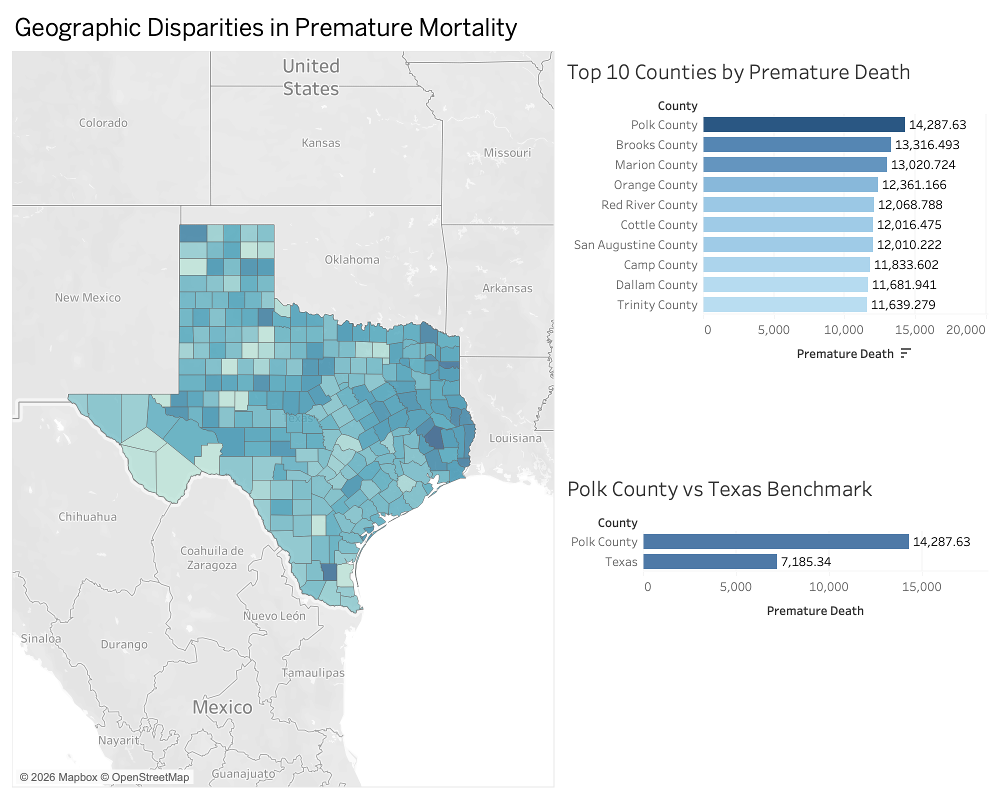
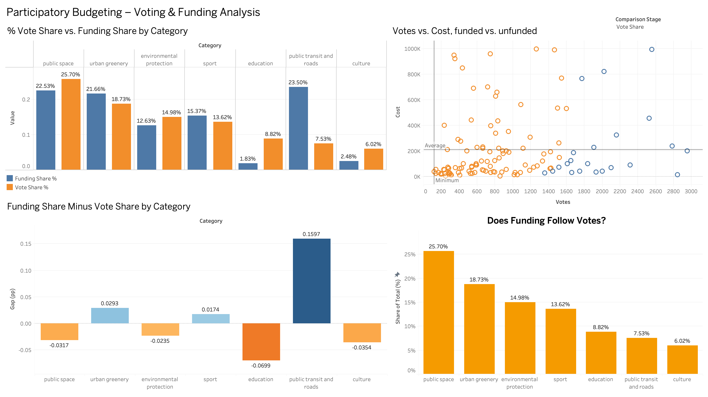
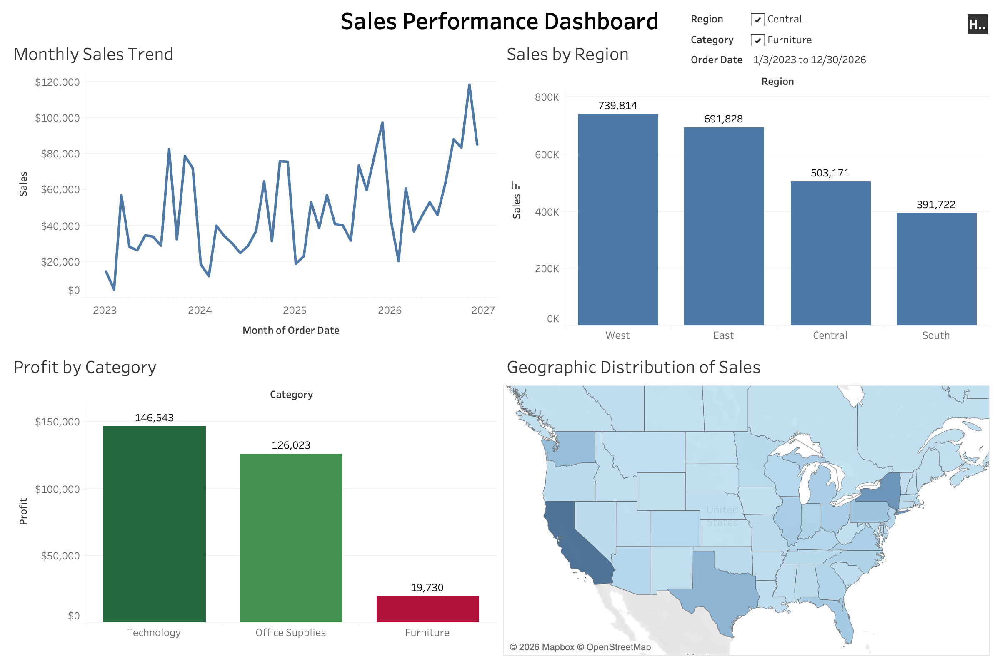
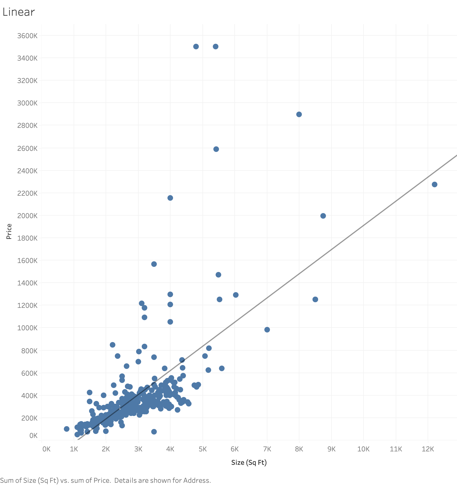
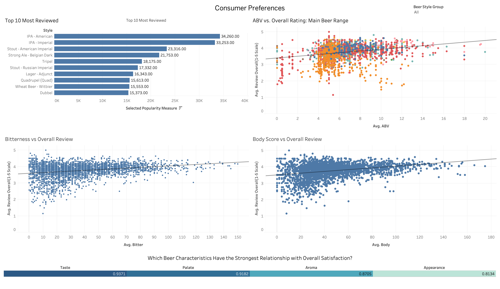
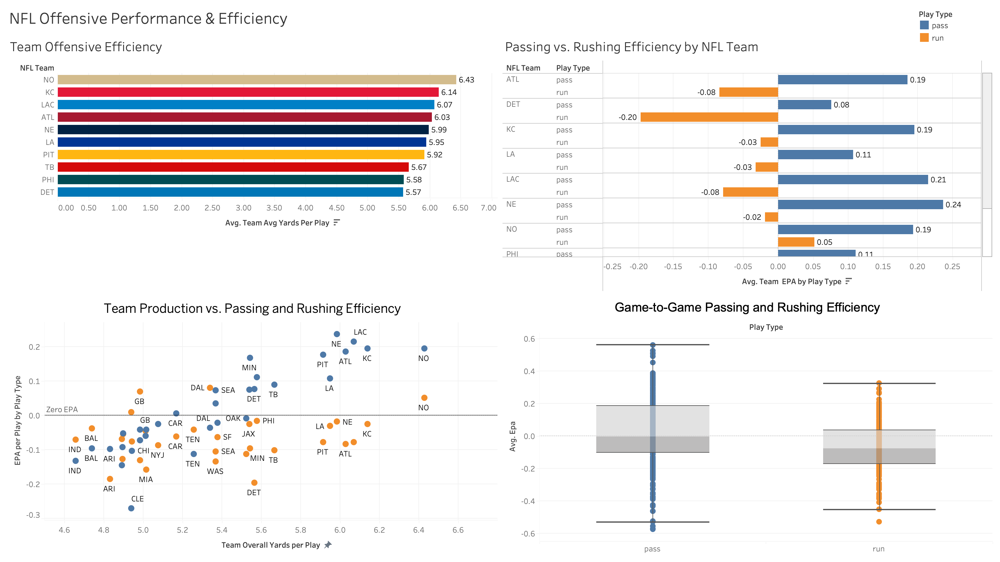

# Tableau Analytics Portfolio

## Overview

A collection of seven end-to-end analytics projects demonstrating business intelligence, statistical analysis, interactive dashboard development, and data-driven decision-making using Tableau.

This portfolio spans multiple industries and analytical domains, including healthcare, economic development, public policy, retail, consumer products, and professional sports.

Each project demonstrates a structured analytical approach, from problem definition and data exploration to visualization development, insight generation, and actionable recommendations.

## Featured Projects

| Project | Domain | Analytical Techniques |
|---|---|---|
| [01 — Global Development & Health Analysis](./01-global-development-health/) | Economic Development & Public Health | FIXED LOD expressions, regression, residual analysis, interactive dashboards |
| [02 — Texas Health Disparities](./02-texas-health-disparities/) | Healthcare Analytics | Geospatial analysis, benchmarking, correlation, historical comparisons |
| [03 — Participatory Budgeting & Voting Fairness](./03-participatory-budgeting/) | Public Policy | Custom fairness metrics, funding allocation, comparative analysis |
| [04 — Superstore Business Analytics](./04-superstore-business-analytics/) | Retail & Business Intelligence | Profitability analysis, KPI development, dynamic dashboards, animations |
| [05 — Advanced Statistical Analysis](./05-advanced-statistical-analysis/) | Statistical & Predictive Analytics | Regression, clustering, forecasting, distribution analysis |
| [06 — Consumer Preferences & Product Development](./06-consumer-preferences-analysis/) | Consumer & Product Analytics | Pearson correlation, dynamic rankings, product segmentation, opportunity mapping |
| [07 — NFL Offensive Efficiency](./07-nfl-offensive-efficiency/) | Sports Analytics | Expected Points Added, FIXED LOD expressions, performance benchmarking, statistical distributions |

## Portfolio Highlights

### 01 — Global Development & Health Analysis

Examines economic development, life expectancy, and global health inequality across 142 countries.

[View Full Project](./01-global-development-health/)

---

### 02 — Texas Health Disparities

Investigates geographic health disparities, premature mortality, and socioeconomic risk factors across Texas counties.

[View Full Project](./02-texas-health-disparities/)

---

### 03 — Participatory Budgeting & Voting Fairness

Evaluates alignment between voter preferences and public funding allocation using custom proportionality metrics and comparative analysis.

[View Full Project](./03-participatory-budgeting/)

---

### 04 — Superstore Business Analytics

Analyzes retail sales, profitability, customer performance, regional trends, and discount strategies using interactive and animated visualizations.

[View Full Project](./04-superstore-business-analytics/)

---

### 05 — Advanced Statistical Analysis

Demonstrates regression modeling, clustering, time-series forecasting, and advanced exploratory data analysis across retail, real estate, and demographic datasets.

[View Full Project](./05-advanced-statistical-analysis/)

---

### 06 — Consumer Preferences & Product Development Analytics

Investigates consumer satisfaction, product characteristics, sensory relationships, and potential product development opportunities using correlation analysis and interactive dashboards.

[View Full Project](./06-consumer-preferences-analysis/)

---

### 07 — NFL Offensive Efficiency Analytics

Evaluates offensive performance using Expected Points Added (EPA), yards per play, passing and rushing efficiency, and team performance benchmarking.

[View Full Project](./07-nfl-offensive-efficiency/)

## Technical Skills

| Competency | Techniques |
|---|---|
| Business Intelligence | KPI development, profitability analysis, benchmarking, performance monitoring |
| Statistical Analysis | Pearson correlation, regression, residual analysis, clustering, forecasting |
| Tableau Calculations | FIXED LOD expressions, calculated fields, table calculations, custom metrics |
| Interactive Analytics | Parameters, context filters, dashboard actions, dynamic zone visibility, sheet swapping |
| Data Visualization | Geographic maps, scatterplots, heatmaps, box plots, waterfall charts, opportunity matrices |
| Data Storytelling | Interactive dashboards, Tableau Stories, animations, analytical presentations |
| Business Analysis | Requirements definition, problem-solving, insight generation, strategic recommendations |
| Exploratory Data Analysis | Data distributions, segmentation, trend identification, outlier investigation |

## Analytical Framework

Each project follows a structured analytical framework:

1. **Problem Definition:** Establish analytical objectives and key business questions.
2. **Data Understanding:** Identify data sources, variables, and relevant characteristics.
3. **Methodology:** Select appropriate analytical techniques and develop calculated metrics.
4. **Model Outputs:** Develop visualizations, dashboards, and statistical analyses.
5. **Insights and Recommendations:** Translate analytical findings into actionable recommendations.
6. **Limitations:** Identify methodological constraints, assumptions, and data limitations.
7. **Conclusion:** Evaluate whether the original analytical objectives were effectively addressed.

## Repository Organization

Project directories contain the following resources, where applicable:

- `README.md` — Comprehensive analytical project documentation
- `workbooks/` — Tableau packaged workbooks
- `presentations/` — Supporting analytical presentations
- `images/` — Dashboard and visualization previews

## Reproducibility

Tableau packaged workbooks can be downloaded and opened using a compatible version of Tableau Desktop.

Dashboard previews and supporting presentations allow users to explore analytical findings without requiring Tableau.

Data sources, analytical methodologies, limitations, and collaborative contributions are documented within the respective project directories.

## About the Author

**Minh Truong**

Technology consulting professional with five years of enterprise systems experience and graduate-level training in business analytics.

Master of Science in Business Analytics  
University of Houston — C. T. Bauer College of Business

Areas of expertise include business analysis, data analytics, business intelligence, enterprise systems, and data-driven decision-making.

[GitHub Profile](https://github.com/mqtruong)
